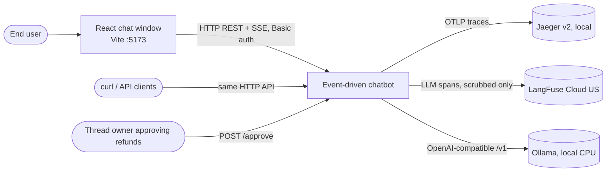

# High-level design

Design intent for the event-driven chatbot. Contracts live in `SPEC.md`; rationale for individual
decisions lives in `docs/adr/`; low-level detail in [`LLD.md`](LLD.md). Statements here describe the
design as planned at 2026-10-17 10:55 CDT; any test-verified behaviour is cited from the task that
verified it.

## 1 · Problem and goals

Synchronous chatbots hold an HTTP request open for the whole LLM call, so load turns into 504s; they
pay a commercial LLM to classify intent; and raw user text (with PII) flows into orchestration,
logs and traces.

| Goal | How the design meets it |
|---|---|
| No request-path timeouts under load | `POST /chat` only validates, scrubs, enqueues and returns 202; generation happens in workers; tokens are pulled over SSE |
| $0 runtime on CPU | Local embeddings (fastembed/ONNX) + Qdrant for intent routing; local Ollama for generation; mock for CI |
| PII never reaches orchestration | Presidio scrub at the gateway before Kafka; model output scrubbed again before checkpoint/log/trace |
| Horizontal scale | Stateless gateway; Kafka partitions bound worker parallelism; all shared state in Redis |
| Safe agent actions | The only side-effecting action (refund request) pauses for explicit human approval |

## 2 · System context



External egress at runtime is LangFuse Cloud only (approved deviation, ADR 0006). Model weights
(spaCy, fastembed, Ollama) are fetched at build time; containers run with `HF_HUB_OFFLINE=1`.

## 3 · Containers and components

```mermaid
flowchart TB
  ui[React chat window - Vite :5173<br/>fetch POST + streamed SSE reader]
  subgraph edge[Gateway replicas - FastAPI/uvicorn :8000]
    auth[Basic auth + thread ownership]
    guard[Input guardrails L1-L3]
    prod[Kafka producer]
    sse[SSE relay]
    appr[Approve endpoint]
  end
  subgraph bus[Kafka 4.3 KRaft :9092]
    req[[chat-requests<br/>KAFKA_PARTITIONS]]
    dlq[[chat-requests.dlq]]
  end
  subgraph work[Worker replicas - consumer group chat-workers]
    dedupe[Dedupe lease]
    graph[LangGraph StateGraph]
    llm[OpenAI-compatible client / mock]
    outg[Output guardrail L5]
  end
  redis[(Redis 8 :6379<br/>streams, checkpoints, dedupe,<br/>rate limit, owners, audit)]
  qdrant[(Qdrant gRPC :6334, REST :6333<br/>intents, injection_patterns)]
  seed[[seed one-shot]]
  auth --> guard --> prod --> req --> dedupe --> graph --> llm --> outg
  ui --> auth
  sse -- SSE --> ui
  graph -- "route (gRPC)" --> qdrant
  outg -- XADD tokens --> redis
  graph -- checkpoint --> redis
  sse -- XREAD --> redis
  appr -- decision --> req
  work -- failures --> dlq
  seed --> qdrant
```

| Component | Responsibility | State |
|---|---|---|
| Gateway | Auth, ownership, validation, rate limit, PII scrub, enqueue, SSE relay, approval intake | None (stateless) |
| Kafka `chat-requests` | Durable, per-thread ordered work queue | Log, keyed by `thread_id` |
| Kafka `chat-requests.dlq` | Poison and exhausted-retry records for inspection/replay | Log |
| Worker | Dedupe, LangGraph run (route → node → inference), output guard, token publish | None beyond Redis |
| Redis 8 | Token streams, LangGraph checkpoints, dedupe leases, rate-limit counters, thread owners, refunds, audit stream | All shared mutable state |
| Qdrant | Intent exemplars and injection exemplars (384-dim cosine) | Seeded once |
| Seed | Embeds and loads the seed files; fails loud | One-shot |
| React chat window | Vite + React + TypeScript SPA: sends turns, renders tokens incrementally, shows error and approval-required states, approve/reject buttons | Credentials and thread id in memory only |
| Ollama | Local CPU inference (`llama3.2:1b`); vLLM on GPU is the documented production path behind the same URL | Model cache |
| Jaeger v2 / LangFuse | Infra traces / LLM-level traces | External to the request path |

## 4 · Key trade-offs

| Decision | Chosen | Alternative | Why | Cost accepted |
|---|---|---|---|---|
| Request handling | Async: 202 + Kafka + SSE | Synchronous call to the LLM | Removes 504s; absorbs bursts in the log | More moving parts; client must open a second connection |
| Intent routing | Embedding top-1 + threshold | LLM classifier | $0, ~ms on CPU, deterministic, testable | Threshold must be calibrated; weaker on paraphrase far from exemplars |
| Browser stream reader | `fetch` + `ReadableStream` SSE parser | `EventSource` | Must send the Basic `Authorization` header and `Last-Event-ID`; `EventSource` cannot set headers | A small hand-written SSE parser to test (A8) |
| Worker → Qdrant transport | gRPC (:6334, `prefer_grpc`) | REST (:6333) | Lead choice; lower per-query overhead, typed protobuf | Deviation from the brief's REST (ADR 0006); REST stays for healthchecks and the seed |
| Token transport | Redis Stream per message + SSE | WebSocket / Kafka per token | Replayable from 0 or `Last-Event-ID`; any gateway replica can serve | Redis memory per message (bounded by MAXLEN + TTL) — ADR 0005 |
| Conversation memory | LangGraph checkpointer on Redis | Postgres checkpointer | One stateful store; Redis already required | Depends on spike (a); fallback Postgres — ADR 0002 |
| Kafka client | confluent-kafka (librdkafka) | aiokafka | Brief-mandated; mature, fast | Async API surface must be verified — ADR 0003 |
| PII model | spaCy `en_core_web_lg` | `sm` / `md` | Better PERSON/LOCATION recall (lead choice) | 382 MB wheel; higher scrub latency, measured in A1b |
| LLM traces | LangFuse Cloud | Self-hosted LangFuse | No extra containers (lead choice) | Scrubbed text leaves the machine — ADR 0006 |
| Access control | HTTP Basic + owner binding in Redis | OAuth/OIDC | Minimal, no external IdP | Cleartext credentials without TLS (Tier 3 cut) — ADR 0007 |

## 5 · Constraints

- Runtime cost $0 on CPU; no commercial or metered LLM endpoint; `LLM_BASE_URL` stays inside the
  compose network.
- No PyTorch in any image (fastembed uses ONNX Runtime).
- Single node for Kafka and Redis; no Kubernetes; the design must not block either.
- CPU-bound work (Presidio, embeddings) runs off the event loop.
- Kafka offsets are committed only after a durable outcome (stream event or DLQ record).
- User text never enters a system prompt; it travels in a delimited data field.

## 6 · Failure modes and degradation

| Fault | Detection | Behaviour | Client sees |
|---|---|---|---|
| Kafka down at POST | Producer error / timeout | No enqueue | 503 |
| Redis down at POST | Rate-limit/owner call fails | No enqueue | 503 |
| Bad credentials / foreign thread | Auth / owner check | Rejected before scrub | 401 / 403 |
| Oversize or invalid body | Size check / Pydantic | Rejected | 413 / 422 |
| Burst on one thread | Redis counter | Rejected | 429 |
| Malformed envelope in Kafka | Pydantic on consume | DLQ immediately, commit, no retry | — |
| Qdrant / LLM / Redis fault in worker | Exception class + timeout | Bounded retries with backoff → `ErrorEvent{dependency_unavailable}` + DLQ → commit | SSE `error` event, stream closes |
| Worker crash mid-message | Lease `processing` never reaches `done` | Offset uncommitted; lease expires; redelivered and reprocessed | Delayed answer, no duplicate `done` |
| Duplicate delivery / repeated POST | Gateway idempotency key / worker `done` key | Same 202 body; worker skips and commits | One stream, one `done` |
| Prompt injection | Injection-collection similarity ≥ threshold | Refusal node; flagged in span + log | Refusal text |
| Refund requested | Billing node | `interrupt()`; nothing applied until approval; expires after `APPROVAL_TTL_S` | `approval_required` event |
| LangFuse unreachable | Exporter error | Logged; never fails the request | — |

## 7 · Scaling model

- Gateway: stateless; scale replicas freely behind any L7 balancer. Any replica can serve any stream
  because streams live in Redis.
- Worker: one consumer group; effective parallelism = `KAFKA_PARTITIONS`; replicas above that idle.
  Per-thread order is preserved by keying on `thread_id`. Changing partition count remaps keys and is
  an ADR decision, never a runtime tweak.
- Redis: single node now; streams are bounded (`STREAM_MAXLEN`, `STREAM_TTL_S`), checkpoints expire
  (`CHECKPOINT_TTL_MIN`). Next step is Redis Cluster with hash-tagged keys per thread.
- Inference: swap Ollama for vLLM on GPU behind the same OpenAI-compatible URL.

## 8 · Security and guardrails

Five layers, detailed in ADR 0007: L1 authentication, ownership and schema/size validation; L2
per-thread rate limit; L3 Presidio scrub before Kafka; L4 prompt-injection defence (structural
separation + embedding detection); L5 output scrub, token cap and system-prompt echo check.
