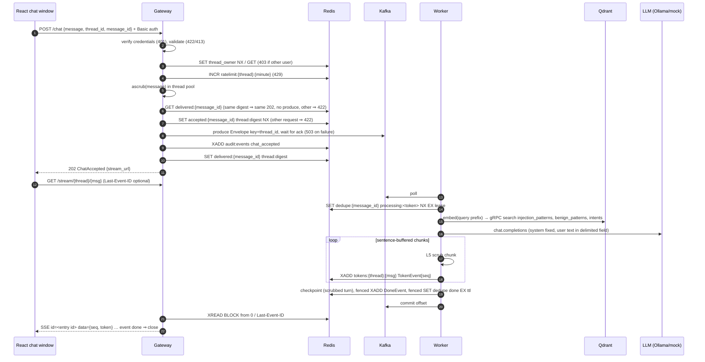
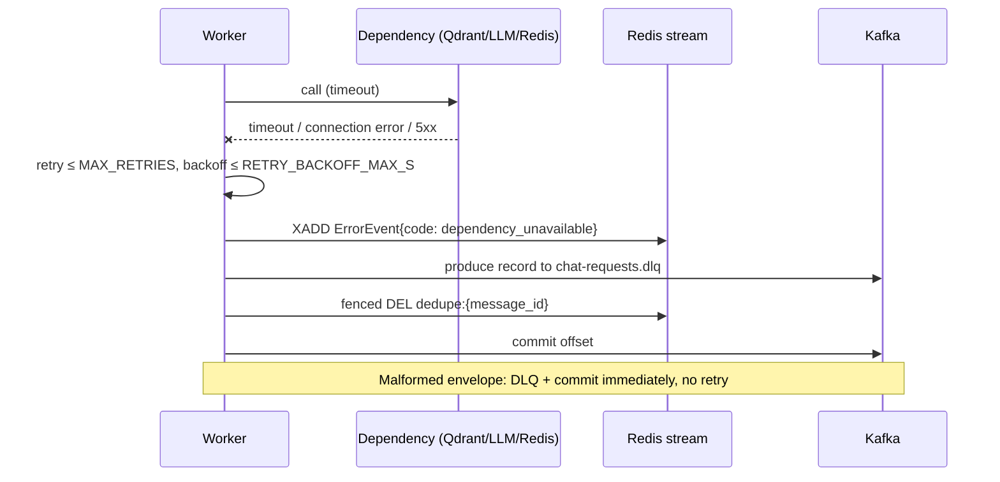
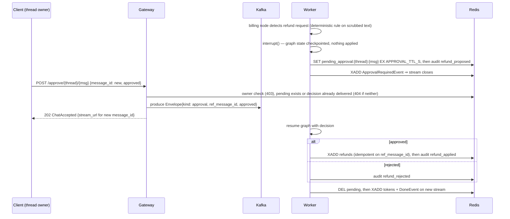
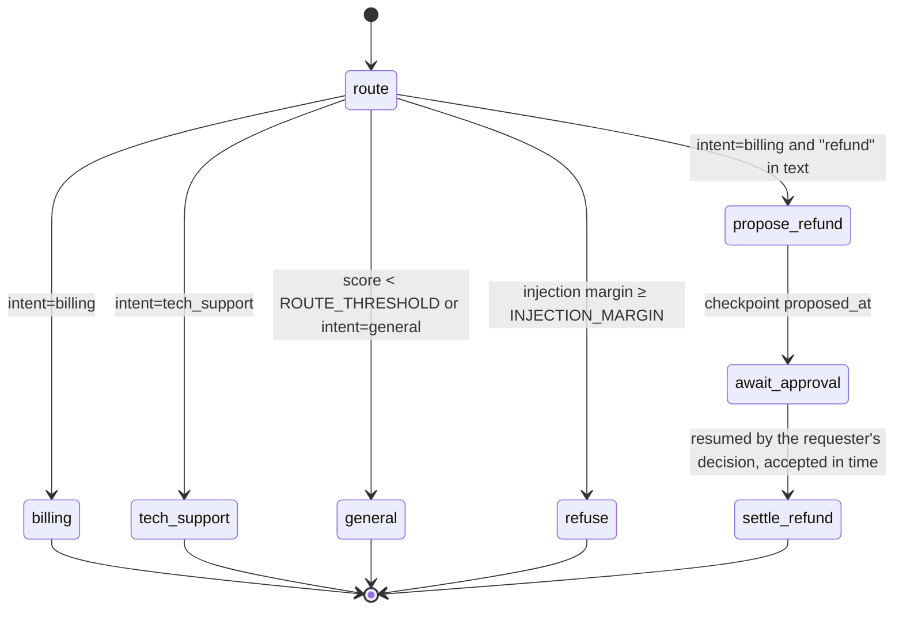
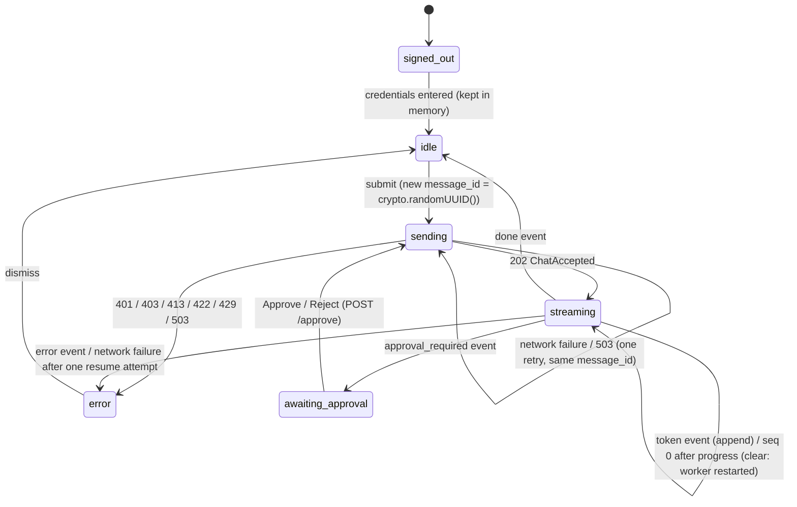

# Low-level design

Companion to [`HLD.md`](HLD.md). Wire contracts are normative in `SPEC.md`; this file explains how the
pieces use them. Planned design as of 2026-10-17 10:55 CDT.

## 1 · Module map

| Module | Owns |
|---|---|
| `chat_common.schemas` | Pydantic v2 models: `ChatRequest`, `ChatAccepted`, `Envelope`, `TokenEvent`, `DoneEvent`, `ErrorEvent`, `ApprovalRequiredEvent`, `ApprovalRequest` |
| `chat_common.settings` | `Settings` (pydantic-settings, env); dedupe-lease formula validator |
| `chat_common.scrubber` | Presidio analyzer/anonymizer; `scrub()` sync, `ascrub()` via `asyncio.to_thread` |
| `chat_common.logjson` | stdlib `logging` JSON formatter carrying `trace_id`, `thread_id`, `message_id` |
| `chat_common.audit` | `audit:events` writer and reader |
| `chat_common.tracing` | OpenTelemetry setup; W3C trace context carried in `Envelope.trace_id` (ADR 0003) |
| `gateway.app` | FastAPI app, routes, exception → status mapping, owner binding, per-thread rate limit, idempotent enqueue |
| `gateway.auth` | HTTP Basic verification (scrypt, called via `asyncio.to_thread`), thread ownership |
| `gateway.producer` | confluent-kafka asyncio producer wrapper |
| `gateway.sse` | Redis stream → SSE relay |
| `worker.consumer` | Poll loop, dedupe lease, retries, DLQ, commit |
| `worker.graph` | LangGraph `StateGraph` definition and the processor (replay idempotency, approval resume) |
| `worker.streams` | Per-message Redis Stream writer |
| `worker.embedding` | fastembed bge-small query/passage embeddings |
| `worker.observability` | LangFuse LLM traces (no-op without keys) |
| `worker.main` | Process wiring: clients, checkpointer, graph, consumer loop |
| `worker.router` | Qdrant top-1 intent + contrastive injection margin (ADR 0004) |
| `worker.llm` | OpenAI-compatible client and deterministic mock; prompt assembly |
| `worker.guards` | L5 output guard: scrub per sentence chunk, block prompt echoes, token cap |
| `worker.approval` | Refund proposal, interrupt/resume, apply |
| `seed.main` / `seed.calibrate` | Load collections; leave-one-out threshold calibration |
| `frontend/src/api.ts` | `postChat`, `postApprove`, `streamMessage` (fetch + SSE parser, Basic header, `Last-Event-ID` resume) |
| `frontend/src/ChatWindow.tsx` | Chat state machine (§11), message list, incremental token rendering, input box, error banner, approve/reject panel |
| `frontend/src/App.tsx` | Username/password form; credentials held in React state only |

## 2 · Sequence: chat turn (happy path)



## 3 · Sequence: failure path



## 4 · Sequence: human approval gate



cannot trigger or approve it. The apply step is one Lua script that Redis runs in isolation. Redis
does not roll back a script on a runtime error, so the script decodes its arguments and checks that
`refunds` and `audit:events` are streams (or absent) before its first write. Then it appends to
`refunds`, appends to `audit:events`, and finally sets the marker to the `refunds` entry id. A
redelivered approval finds the marker and its entry and returns "already applied". A marker whose
entry is missing raises an error instead. The marker never expires.
failed write never leaves a marker without its refund record. The marker never expires.

## 5 · LangGraph state machine



`billing`, `tech_support`, `general` and `refuse` all run `respond` (stream through the output
guard, append the user+assistant pair). State (`ChatState`, `worker/graph.py`): `turns:
list[{role, text}]` (scrubbed, appended), `pending` (scrubbed text of the current turn),
`message_id`, `user_id`, `intent`, `route_score`, `injection_score`, `decision` (approval resume
payload), `answered` (message_id whose reply is the last turn). Before invoking, the processor reads
the checkpoint: `answered == message_id` ⇒ re-send that reply; paused on this message ⇒ re-announce
`approval_required`; paused on another message and a chat arrives ⇒ abandon it (`refund_abandoned`).

## 6 · Redis key schema

| Key | Type | Written by | TTL / bound | Purpose |
|---|---|---|---|---|
| `tokens:{thread_id}:{message_id}` | Stream | worker | `MAXLEN ~ STREAM_MAXLEN`, `EXPIRE STREAM_TTL_S` | Token/done/error/approval events |
| `dedupe:{message_id}` | String `processing:<token>`/`done` | worker | `DEDUPE_LEASE_S` / `DEDUPE_TTL_S` | At-least-once → effectively-once. Stream, `done`/release and refund writes check the token in the same script (ADR 0009) |
| `accepted:{message_id}` | String (`thread_id:request digest`) | gateway | `DEDUPE_TTL_S` | Binds the id to one request (422 otherwise) |
| `delivered:{message_id}` | String (`thread_id:request digest`) | gateway | `DEDUPE_TTL_S` | Set after the broker ack and the acceptance audit; same request ⇒ same 202, no produce; other ⇒ 422 |
| `ratelimit:{thread_id}:{epoch_min}` | Counter | gateway | 60 s | 429 |
| `thread_owner:{thread_id}` | String (user) | gateway | none (outlives checkpoints, which refresh on read) | Access binding |
| `pending_approval:{thread_id}:{message_id}` | String (user) | worker | `APPROVAL_TTL_S` | Approval window |
| `refund_applied:{message_id}` | String (`refunds` entry id) | worker | none | Apply idempotency and receipt (written last by the same script as `refunds` and the audit entry) |
| `refunds` | Stream | worker | none | The side effect being gated |
| `audit:events` | Stream | gateway, worker | `MAXLEN ~ 100000` | Durable, queryable runtime audit trail |
| checkpointer keys | JSON (library-managed) | worker | `CHECKPOINT_TTL_MIN` | Conversation memory per `thread_id` |

## 7 · Kafka

| Topic | Partitions | Key | Value |
|---|---|---|---|
| `chat-requests` | `KAFKA_PARTITIONS` | `thread_id` | `Envelope` JSON |
| `chat-requests.dlq` | 1 | `thread_id` (or null if unparseable) | `{reason, error, original (base64 if not JSON)}` |

`Envelope = {message_id, thread_id, user_id, text, ts, trace_id, kind: "chat"|"approval",
ref_message_id?, approved?}`. Trace context travels only in `trace_id`: the async producer does not
support per-message headers (spike b, ADR 0003). Consumer: `enable.auto.commit=false`; commit after the durable outcome.

## 8 · API status matrix

| Endpoint | 2xx | 401 | 403 | 404 | 413 | 422 | 429 | 503 |
|---|---|---|---|---|---|---|---|---|
| `POST /chat` | 202 `ChatAccepted` | bad/missing creds | thread owned by another user | — | message > `MAX_MESSAGE_CHARS` | invalid body / `thread_id` / reused `message_id` on another thread | per-thread rate | Kafka or Redis down |
| `GET /stream/{t}/{m}` | 200 SSE | bad/missing creds | not owner | no stream and no `delivered:{m}` | — | invalid ids | — | Redis down |
| `POST /approve/{t}/{m}` | 202 `ChatAccepted` | bad/missing creds | not owner | no pending approval | — | invalid body | — | Kafka or Redis down |
| `GET /healthz` | 200 (liveness) | — | — | — | — | — | — | — |
| `GET /readyz` | 200 (Redis + Kafka topic) | — | — | — | — | — | — | dependency down |

Infra faults never map to 4xx; caller faults never map to 5xx.

## 9 · Prompt assembly (L4 structural defence)

```
system: <fixed constant per intent node, byte-identical every call>
user:   <user_message>{scrubbed text, delimiters escaped}</user_message>
        <history>{last turns, scrubbed}</history>
```

The system prompt instructs the model to treat everything inside the tags as data. A7 asserts the
system prompt is byte-identical to the baseline and that injected text appears only inside
`<user_message>`.

## 10 · Output guard and streaming

The worker buffers model deltas and cuts after the last sentence end, meaning `.`/`!`/`?` followed
by whitespace, or a newline. A dot inside `jane.doe` or `192.168` is not a sentence end. Past 200
chars without one, it cuts only at a space between two complete lowercase words, or at 1000 chars.
Each chunk is scrubbed off-loop and checked for a system-prompt echo, then its tokens are XADDed.
Echoed `<user_message>` / `<history>` blocks and stray delimiter tags are removed first, and cuts
never fall inside an echoed block; while such a block is still open the guard keeps buffering (up
to 2000 chars). This trades a little time-to-first-token for the guarantee that unscrubbed output
never reaches the stream, checkpoint, logs or traces. Residual risk: an entity spanning a cut made
at the 1000-char hard limit, or a lowercase multi-word entity at a forced cut.

## 11 · React chat window

Vite + React 19 + TypeScript 6 single-page app in `frontend/`, served on :5173 in development and as a
compose service built from `node:24.22.0-slim`. The gateway's `CORS_ORIGINS` allowlists its origin.



- **Streaming:** `fetch(stream_url, {headers: {Authorization, Last-Event-ID?}})`, read
  `response.body` with a `TextDecoder`, split on blank lines, parse `id:` / `event:` / `data:`. On
  a dropped connection it retries once with the last seen `id` as `Last-Event-ID`; SPEC §6 makes
  this gap- and duplicate-free.
- **Incremental render:** tokens append to the current assistant message as they arrive; `seq` is
  checked to be increasing and duplicates are ignored.
- **Error state:** HTTP status or `ErrorEvent.code` maps to a readable banner (401 asks the user to
  sign in again; it does not sign out).
- **Approval:** `ApprovalRequiredEvent` shows Approve / Reject buttons; the click POSTs `/approve`
  with a fresh `message_id` and streams the follow-up message.
- **Retry identity:** an uncertain POST (network failure or 503) is retried once with the same body,
  so the same `message_id`; the gateway produces it or returns the original 202 (SPEC §2).
- **Tests (A8, Vitest + React Testing Library):** a stubbed `fetch` streams events; asserts tokens
  appear incrementally, the error banner renders on `ErrorEvent`, and the approval panel appears on
  `approval_required`.

## 12 · Qdrant transport

The worker uses `AsyncQdrantClient(host, grpc_port=6334, prefer_grpc=True)` for search (lead
choice, ADR 0006). The seed service and compose healthcheck keep REST on :6333. Both ports are
published only inside the compose network.
