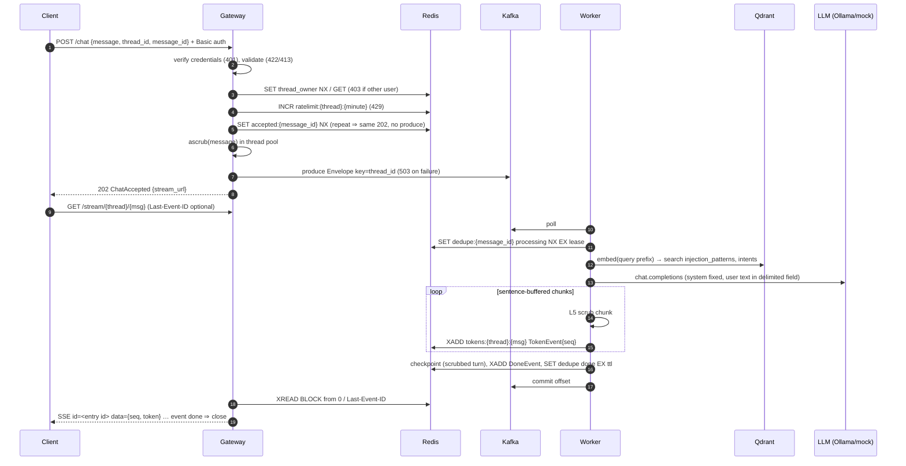
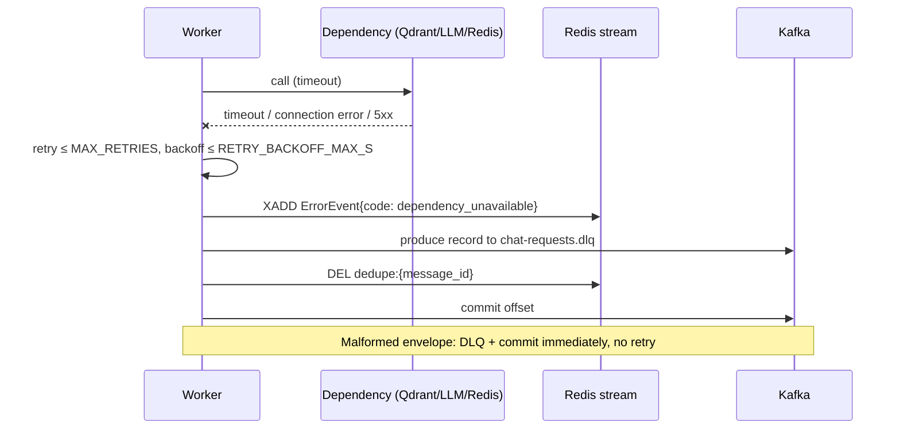
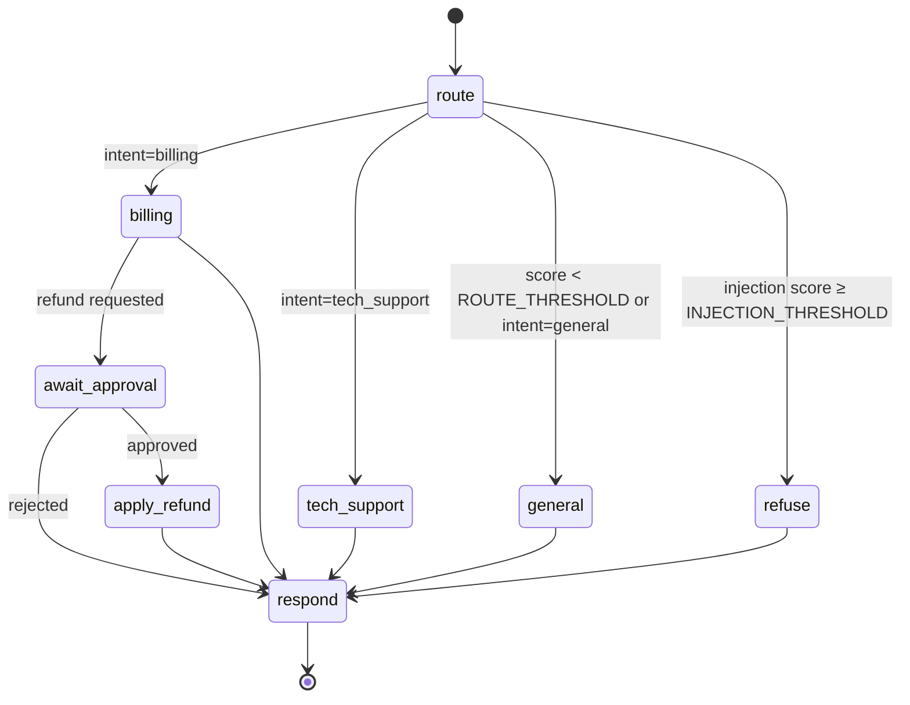

# Low-level design

Companion to [`HLD.md`](HLD.md). Wire contracts are normative in `SPEC.md`; this file explains how the
pieces use them. Planned design as of 2026-10-17 10:55 CDT.

## 1 · Module map

| Module | Owns |
|---|---|
| `chat_common.schemas` | Pydantic v2 models: `ChatRequest`, `ChatAccepted`, `Envelope`, `TokenEvent`, `DoneEvent`, `ErrorEvent`, `ApprovalRequiredEvent`, `ApprovalRequest` |
| `chat_common.settings` | `Settings` (pydantic-settings, env); dedupe-lease formula validator |
| `chat_common.scrubber` | Presidio analyzer/anonymizer; `scrub()` sync, `ascrub()` via `asyncio.to_thread` |
| `chat_common.logjson` | stdlib `logging` JSON formatter carrying `trace_id`, `thread_id`, `message_id` |
| `chat_common.audit` | `audit:events` writer and reader |
| `gateway.app` | FastAPI app, routes, exception → status mapping |
| `gateway.auth` | HTTP Basic verification (scrypt), thread ownership |
| `gateway.ratelimit` | Per-thread fixed-window counter |
| `gateway.producer` | confluent-kafka asyncio producer wrapper |
| `gateway.sse` | Redis stream → SSE relay |
| `worker.consumer` | Poll loop, dedupe lease, retries, DLQ, commit |
| `worker.graph` | LangGraph `StateGraph` definition + checkpointer |
| `worker.router` | Embedding + Qdrant top-1 + thresholds |
| `worker.llm` | OpenAI-compatible client and deterministic mock; prompt assembly |
| `worker.guards` | L4 injection check, L5 output guard |
| `worker.approval` | Refund proposal, interrupt/resume, apply |
| `seed.main` / `seed.calibrate` | Load collections; leave-one-out threshold calibration |

## 2 · Sequence: chat turn (happy path)



## 3 · Sequence: failure path



## 4 · Sequence: human approval gate

```mermaid
sequenceDiagram
  participant C as Client (thread owner)
  participant G as Gateway
  participant K as Kafka
  participant W as Worker
  participant R as Redis
  W->>W: billing node detects refund request (deterministic rule on scrubbed text)
  W->>W: interrupt() — graph state checkpointed, nothing applied
  W->>R: SET pending_approval:{thread}:{msg} EX APPROVAL_TTL_S; audit refund_proposed
  W->>R: XADD ApprovalRequiredEvent ⇒ stream closes
  C->>G: POST /approve/{thread}/{msg} {message_id: new, approved}
  G->>R: owner check (403), pending exists (404 if expired/unknown)
  G->>K: produce Envelope{kind: approval, ref_message_id, approved}
  G-->>C: 202 ChatAccepted {stream_url for new message_id}
  W->>W: resume graph with decision
  alt approved
    W->>R: XADD refunds (idempotent on ref_message_id); audit refund_applied
  else rejected
    W->>R: audit refund_rejected
  end
  W->>R: DEL pending; XADD tokens + DoneEvent on new stream
```

The refund decision is made by a deterministic rule, not by model output, so an injected prompt
cannot trigger or approve it. The apply step is idempotent on `ref_message_id` (Redis `SET NX`
marker before XADD), so a redelivered approval never applies twice.

## 5 · LangGraph state machine



State (`TypedDict`): `thread_id`, `message_id`, `user_id`, `turns: list[{role, text}]` (scrubbed),
`intent`, `route_score`, `injection_score`, `refund: {status, ref_message_id} | None`.

## 6 · Redis key schema

| Key | Type | Written by | TTL / bound | Purpose |
|---|---|---|---|---|
| `tokens:{thread_id}:{message_id}` | Stream | worker | `MAXLEN ~ STREAM_MAXLEN`, `EXPIRE STREAM_TTL_S` | Token/done/error/approval events |
| `dedupe:{message_id}` | String `processing`/`done` | worker | `DEDUPE_LEASE_S` / `DEDUPE_TTL_S` | At-least-once → effectively-once |
| `accepted:{message_id}` | String (thread_id) | gateway | `DEDUPE_TTL_S` | Idempotent 202 |
| `ratelimit:{thread_id}:{epoch_min}` | Counter | gateway | 60 s | 429 |
| `thread_owner:{thread_id}` | String (user) | gateway | `CHECKPOINT_TTL_MIN` | Access binding |
| `pending_approval:{thread_id}:{message_id}` | String (user) | worker | `APPROVAL_TTL_S` | Approval window |
| `refund_applied:{message_id}` | String | worker | `DEDUPE_TTL_S` | Apply idempotency |
| `refunds` | Stream | worker | none | The side effect being gated |
| `audit:events` | Stream | gateway, worker | `MAXLEN ~ 100000` | Durable, queryable runtime audit trail |
| checkpointer keys | JSON (library-managed) | worker | `CHECKPOINT_TTL_MIN` | Conversation memory per `thread_id` |

## 7 · Kafka

| Topic | Partitions | Key | Value |
|---|---|---|---|
| `chat-requests` | `KAFKA_PARTITIONS` | `thread_id` | `Envelope` JSON |
| `chat-requests.dlq` | 1 | `thread_id` (or null if unparseable) | `{reason, error, original (base64 if not JSON)}` |

`Envelope = {message_id, thread_id, user_id, text, ts, trace_id, kind: "chat"|"approval",
ref_message_id?, approved?}`. Trace context also travels as a per-message header when spike (b)
confirms header support. Consumer: `enable.auto.commit=false`; commit after the durable outcome.

## 8 · API status matrix

| Endpoint | 2xx | 401 | 403 | 404 | 413 | 422 | 429 | 503 |
|---|---|---|---|---|---|---|---|---|
| `POST /chat` | 202 `ChatAccepted` | bad/missing creds | thread owned by another user | — | message > `MAX_MESSAGE_CHARS` | invalid body / `thread_id` / reused `message_id` on another thread | per-thread rate | Kafka or Redis down |
| `GET /stream/{t}/{m}` | 200 SSE | bad/missing creds | not owner | — | — | invalid ids | — | Redis down |
| `POST /approve/{t}/{m}` | 202 `ChatAccepted` | bad/missing creds | not owner | no pending approval | — | invalid body | — | Kafka or Redis down |
| `GET /healthz` | 200 | — | — | — | — | — | — | dependency down |

Infra faults never map to 4xx; caller faults never map to 5xx.

## 9 · Prompt assembly (L4 structural defence)

```
system: <fixed constant per intent node, byte-identical every call>
user:   <user_message>{scrubbed text, delimiters escaped}</user_message>
        <history>{last turns, scrubbed}</history>
```

The system prompt instructs the model to treat everything inside the tags as data. A7 asserts the
system prompt is byte-identical to the baseline and that injected text appears only inside
`<user_message>`.

## 10 · Output guard and streaming

The worker buffers model tokens until a sentence boundary (or 200 chars), runs the scrubber on that
chunk off-loop, checks for a system-prompt echo, then XADDs the chunk's tokens. This trades a little
time-to-first-token for the guarantee that unscrubbed output never reaches the stream, checkpoint,
logs or traces. An entity split across a chunk boundary is a known residual risk.
